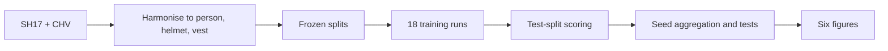

# ppe-compliance-detection

Benchmarking YOLOv8, YOLO11 and YOLO26 for PPE-compliance detection: 18 training runs, a cross-dataset transfer study and a real-time zone-compliance monitor. Code for an MSc dissertation (WMG, University of Warwick).

[](https://github.com/Onkar-Gupta/ppe-compliance-detection/actions/workflows/tests.yml) [](LICENSE)

## Quick Start

```bash
git clone https://github.com/Onkar-Gupta/ppe-compliance-detection && cd ppe-compliance-detection
pip install torch torchvision --index-url https://download.pytorch.org/whl/cpu
pip install -r requirements.txt
pytest -q          # 201 tests, no GPU, datasets or weights needed (1 skips without a local cache)
```

Training needs an NVIDIA GPU. See [Use your own data](#use-your-own-data).

## Demo

Demo GIF and landing page: TBC.

## What it does

It answers one question: **for a PPE-detection system, does the choice of detector matter more than the dataset it was trained on?** Three nano detectors (YOLOv8n, YOLO11n, YOLO26n) were each trained three times (seeds 0, 1, 2) on each of two datasets (SH17 and CHV), 18 runs in all. Every run was then tested on the held-out test split of both datasets, so each score is either in-domain or cross-dataset. A violation axis scores helmet and vest recall zero-shot on Pictor-PPE, an efficiency axis measures latency, and a zone monitor turns the detections into dwell-gated alerts.

## Results

All numbers come from [`results/`](results/), and each folder there says which command produced it. Scores are on the frozen **test** splits, which no training run read. Mean of 3 seeds with a 95 % BCa bootstrap interval.

**Accuracy (mAP50).** Rows are the dataset the model trained on.

| Trained on | Tested on | YOLOv8n | YOLO11n | YOLO26n |
|---|---|---|---|---|
| CHV | CHV (in-domain) | 0.892 [0.882, 0.898] | 0.893 [0.887, 0.899] | 0.881 [0.876, 0.884] |
| CHV | SH17 (cross) | 0.524 [0.511, 0.532] | 0.507 [0.490, 0.520] | 0.524 [0.516, 0.530] |
| SH17 | SH17 (in-domain) | 0.666 [0.662, 0.669] | 0.671 [0.663, 0.677] | 0.665 [0.660, 0.669] |
| SH17 | CHV (cross) | 0.792 [0.786, 0.795] | 0.784 [0.769, 0.792] | 0.759 [0.741, 0.770] |

**What the numbers say.**
- **The dataset moves the score far more than the architecture.** A CHV-trained model drops by 0.35 to 0.40 mAP50 when tested on SH17. An SH17-trained model rises by 0.08 to 0.13 on CHV, because CHV is the easier set. Across the three architectures the in-domain scores differ by less than 0.02.
- **No architecture difference survives correction.** The five omnibus Friedman tests have raw p-values of 0.030, 0.135, 0.311, 0.513 and 0.847. After Holm correction the smallest is 0.15, so none is significant. Three seeds is also too few to claim the architectures are equivalent, and the summary file says so. See [`results/X05-stats/`](results/X05-stats/X05-stats-summary.md).

**Helmet recall on Pictor-PPE (zero-shot, 774 images, 2,497 workers).** SH17-trained models reach 0.69 to 0.73, CHV-trained models 0.46 to 0.55. Helmet precision runs the other way (0.46 to 0.50 against 0.63 to 0.71). Only 59 to 73 % of workers were detected at all, so finding the person is the bottleneck. Per-run figures are in [`results/X05-violation/`](results/X05-violation/X05-violation-summary.md).

**Efficiency** (batch 1, 640 px, end to end, RTX 4070 Laptop GPU; a proxy for deployment cost, not an edge-device measurement):

| Model | Parameters | GPU latency | GPU FPS | CPU-constrained latency |
|---|---|---|---|---|
| YOLOv8n | 3.01 M | 10.6 ms | 94.3 | 49.8 ms |
| YOLO11n | 2.59 M | 12.6 ms | 79.2 | 51.5 ms |
| YOLO26n | 2.51 M | 13.7 ms | 73.1 | 68.1 ms |

The CPU figures come from one run per model, so treat them as rough.

**Training cost.** After an offline pre-resize fixed an I/O bottleneck, mean epoch time fell from 244.8 s (42 epochs) to 45.0 s (3 epochs), about 5.4 times faster. This is one pilot run each ([`results/X03-timing/`](results/X03-timing/)).

The six figures are in [`results/X05-figures/`](results/X05-figures/), including the critical-difference diagram and the transfer grid. Monitor results (alerts by zone, end-to-end latency) are not in the repo yet: TBC.

## How it works




1. **Harmonise.** `src/harmonise.py` maps both datasets to three classes (person, helmet, vest) and freezes the splits, excluding cross-dataset near-duplicates so a transfer score cannot be inflated by an image the model met in training.
2. **Train.** `src/run.py` trains one run from a frozen config. `src/grid.py` runs all 18 as a resumable queue. A config is never edited after its run starts: a change means a new run ID.
3. **Score.** `src/score.py`, `src/violation.py` and `src/efficiency.py` measure accuracy, violation recall and speed. `src/stats.py` aggregates seeds and runs the paired sign-flip, Friedman and Nemenyi tests.
4. **Monitor.** `src/monitor.py` links each person to the PPE they wear with a containment rule (threshold 0.80, calibrated on the training splits only), checks the person's feet against a drawn zone, and fires one alert only after a dwell time, with a short memory so a helmet hidden for two frames does not flip a worker to violating.

**Pictor-PPE is evaluation-only.** `src/guards.py` makes a training config that touches it fail before the first batch, so it cannot contaminate the transfer study.

## Project structure

```text
src/               pipeline: harmonise, preresize, run, grid, score, violation,
                   efficiency, stats, figures, associate, zone, dwell, monitor, dashboard
scripts/           verify_env.py (GPU and data check), roc_sweep.py, make_demo_clip.py
configs/           base.yaml (training template), demo.yaml (monitor),
                   X03-*.yaml and X04-*.yaml (one frozen config per run),
                   splits/ (the six frozen image lists and a manifest),
                   data/ (dataset YAMLs), zones/, trackers/
results/           result files behind every number above, with its own README
tests/             201 tests; the logic that decides a claim is tested, not sampled
notebooks/         empty placeholder for exploration notebooks (jupytext pairing is in jupytext.toml)
```

## Configuration

Settings live in YAML. `configs/base.yaml` is the training template. `configs/demo.yaml` controls the monitor:

| Key | Value | Meaning |
|---|---|---|
| `conf` | 0.25 | Detector confidence (the point the violation axis was scored at) |
| `association_threshold` | 0.80 | Containment threshold linking a person to PPE |
| `required_ppe` | helmet, vest | What the zone requires |
| `dwell_seconds` | 3.0 | Continuous non-compliance before one alert fires |
| `memory_seconds` | 1.0 | How long PPE stays believed after it was last seen |
| `grace_seconds` | 2.0 | How long a worker may go undetected before the incident ends |

Paths are repo-relative: datasets in `datasets/`, outputs in `runs/` (both gitignored). To keep them elsewhere, make `datasets` and `runs` symlinks or junctions, or edit `configs/base.yaml`.

## Use your own data

You need an NVIDIA GPU (the results were produced on an 8 GB RTX 4070 Laptop).

1. Install the CUDA build of torch first, then the rest: `pip install torch torchvision --index-url https://download.pytorch.org/whl/cu124` and `pip install -r requirements.txt`. `requirements.lock` holds the exact versions the results used (Windows, CUDA 12.4).
2. Download SH17 and CHV into `datasets/SH17_dataset` and `datasets/CHV_dataset`. Pictor-PPE, if you have it, goes in `datasets/pictor-ppe_dataset` and is never trained on.
3. `python scripts/verify_env.py`, then `python -m src.harmonise` and `python -m src.preresize`. These rewrite `configs/data/*.yaml` with absolute paths for your machine. The committed copies are placeholders.
4. Train one run with `python -m src.run --config configs/X04-y8n-s0-sh17.yaml`, or the whole grid with `python -m src.grid run`. Score with `python -m src.score`.

To run the monitor on your own clip, put it at `datasets/demo/clip.mp4`, draw a zone with `python -m src.zone --source datasets/demo/clip.mp4 --name my-zone`, point `configs/demo.yaml` at your weights and zone, then `python -m src.monitor --config configs/demo.yaml`. `python -m src.dashboard` serves a local page (http://127.0.0.1:8000) to pick a source, drag a zone and watch the annotated stream. Nothing leaves your machine.

## Command reference

Each stage is one module, run as `python -m src.<module>`. Later stages read earlier stages' files and never recompute them. Order matters: `score`, `violation` and `efficiency` before `stats`, and `stats` before `figures`.

| Stage | Command | Produces |
|---|---|---|
| Label audit | `python -m src.audit_labels` | SH17 and CHV label audit |
| Domain shift | `python -m src.eda` | class balance, resolution, shift |
| Near-duplicates | `python -m src.overlap` | the cross-dataset exclusion list |
| Harmonise | `python -m src.harmonise` | shared labels and frozen splits |
| Pre-resize | `python -m src.preresize` | 640 px training copy |
| Association rule | `python -m src.associate` | the containment threshold |
| Train one run | `python -m src.run --config configs/<run-id>.yaml` | weights and a validation summary |
| Train the grid | `python -m src.grid run` | all 18 runs, resumable |
| Accuracy | `python -m src.score` | test-split scores |
| Violation recall | `python -m src.violation` | zero-shot compliance on Pictor-PPE |
| Efficiency | `python -m src.efficiency` | latency and throughput |
| Aggregate | `python -m src.stats` | mean, interval and tests |
| Figures | `python -m src.figures` | the six figures |
| Monitor | `python -m src.monitor --config configs/demo.yaml` | violation log and snapshots |

Run IDs follow `X04-<model>-s<seed>-<dataset>`, where model is `y8n`, `y11n` or `y26n` and dataset is the one trained on (`sh17` or `chv`). 3 models x 3 seeds x 2 datasets = 18 runs. Fixed across every run: image size 640, batch 16, mixed precision, up to 200 epochs with early-stop patience 50.

The committed split lists in `configs/splits/` are the exact splits every number was scored on. Each has an ID, the first 12 characters of a hash of its sorted image names, recorded in `split-manifest.json`. `tests/test_harmonise.py` recomputes all six on every run, so a list cannot drift from the manifest. The lists hold the Windows paths training read; the ID depends only on the file names.

## Reproducing a number

Scoring is deterministic, so re-scoring a set of weights on a frozen split returns the same numbers. On 2026-08-11 the accuracy axis was re-run from a fresh clone and a fresh environment for run `X04-y8n-s2-chv`, chosen because it trained start to finish with no resume. All 16 reported values matched bit for bit, for example in-domain mAP50 0.9009138488046622 (the record is in [`results/S7-repro-clean/`](results/S7-repro-clean/)). Retraining is a weaker claim: cuDNN and mixed precision are non-deterministic on this hardware, so a retrained run lands near its original and not on it. The weights are not distributed.

## Docker

Not provided.

## Limits

- **Nano models only, three seeds.** Three seeds is a floor, not a comfortable sample. Within one training dataset, an exact paired sign-flip on three seeds cannot return a p-value below 0.25, so a null result means underpowered, not equivalent.
- **Latency is a proxy.** It was measured on a laptop GPU and a constrained CPU, not on edge hardware, and the CPU figures are one run each.
- **Person detection is the bottleneck.** The violation axis counts an undetected worker as a missed violation, and only 59 to 73 % of workers were detected.
- **The monitor is a demonstration.** Its alert accuracy and latency results are not in this repo yet (TBC), and no labelled site footage is included.
- **Weights are not distributed**, and the datasets keep their own terms, so reproducing a number needs the datasets and a trained run.
- **The work ran in July and August 2026.** This repository is a cleaned copy of the code with a new history, so commit hashes differ from the original.

## Roadmap

- Landing page with a saved replay of the monitor on an open-licensed clip.
- Monitor results (alerts by zone, end-to-end latency) added to `results/`.
- A Dockerfile for the CPU-only parts.

## Licence and citation

Code: MIT, copyright (c) 2026 Onkar Gupta. The datasets are not redistributed and keep their own terms: SH17 is CC BY-NC-SA 4.0, and CHV and Pictor-PPE follow their sources. Trained weights are not distributed.

```bibtex
@mastersthesis{gupta2026ppe,
  author = {Gupta, Onkar},
  title  = {Benchmarking Modern Object Detectors for PPE-Compliance Detection:
            a deployment-readiness framework and cross-dataset generalisation study},
  school = {WMG, University of Warwick},
  year   = {2026},
  note   = {Code: https://github.com/Onkar-Gupta/ppe-compliance-detection}
}
```

The dissertation cites an earlier copy of this code at `github.com/Onkar2003-lab/ppe-compliance-detection` (tags `v1.0-results` and `v1.1-demo`).

## Author

Onkar Gupta, MSc Applied AI, WMG, University of Warwick. [LinkedIn](https://linkedin.com/in/onkar-gupta-ai)
